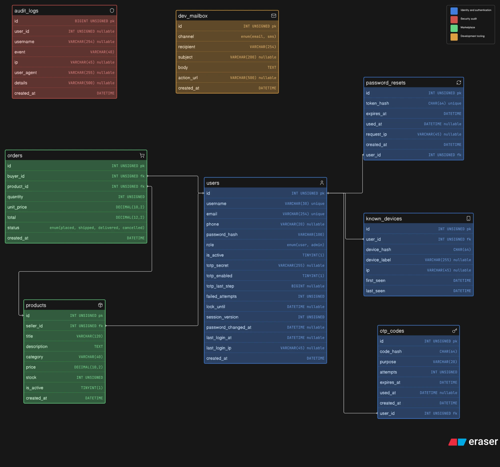

# ShostaBazar: A Secure Online Marketplace

**ShostaBazar** (শস্তা বাজার, *"cheap market"*) is an online marketplace web application built as a **Cyber Security course project**. Users can register, sign in with two-factor authentication, search and buy products, and list their own items for sale. Administrators manage users, products and security logs from a dashboard.

The focus of the project is **security**: every requirement of the course brief is implemented and documented below, together with additional protections.

| | |
|---|---|
| **Course** | Cyber Security |
| **Project type** | Web application (Node.js + MySQL) |
| **Team members** | *S.M. Akhlakur Rahman Miraj(ID: 20234103245)* · *Name (ID)* |
| **Course teacher** | *Name* |
| **Repository** | https://github.com/Miraj0013/Project |

---

## Table of contents

1. [Features](#1-features)
2. [Security requirements and implementation](#2-security-requirements-and-implementation)
3. [Technology stack](#3-technology-stack)
4. [System architecture](#4-system-architecture)
5. [Project structure](#5-project-structure)
6. [Database design](#6-database-design)
7. [Getting started](#7-getting-started)
8. [Configuration](#8-configuration)
9. [Testing](#9-testing)
10. [Security demonstration guide](#10-security-demonstration-guide)
11. [Deployment](#11-deployment)
12. [Limitations and future work](#12-limitations-and-future-work)

---

## 1. Features

### User features
- Register with username, email, optional mobile number and a strong password (live strength meter)
- Sign in with username **or** email, followed by a **6-digit verification code** (email/SMS) or an **authenticator app** code
- Marketplace dashboard with **search**, category filter, sorting and pagination
- Sell items: create listings, view and remove your own listings
- Buy items and view order history
- Security settings: change password, add a phone number for SMS alerts, set up an authenticator app (QR code), manage recognised devices, view recent security activity
- Forgot password: one-time reset link by email

### Administrator features
- Dashboard with statistics: users, products, orders, sales volume, failed logins, locked accounts, blocked attacks, 7-day sign-in chart
- **User management with search:** unlock, disable/enable, promote/demote, revoke all sessions
- **Security log viewer** with search and event filter
- Product moderation with search and removal

---

## 2. Security requirements and implementation

### 2.1 Course requirements

| # | Requirement | Implementation | Code |
|---|---|---|---|
| 1 | **Username and password** | Usernames: 3–30 characters, letters, digits and `_`. Login accepts username or email. | `src/routes/auth.js`, `src/utils/validate.js` |
| 2 | **Two-factor authentication** | Every login requires a second factor: a 6-digit one-time code (email, plus SMS if a phone is set) valid for 5 minutes, **or** a TOTP authenticator app (RFC 6238) set up with a QR code. TOTP secrets are encrypted with AES-256-GCM, and a TOTP code cannot be reused. | `src/services/auth.js`, `src/routes/auth.js`, `src/routes/account.js` |
| 3 | **Hashed passwords** | bcrypt with a random salt and cost factor 12. Plain-text passwords are never stored or logged. | `src/routes/auth.js` |
| 4 | **Timeout after 3 failed attempts** | 3 wrong passwords **or** wrong 2FA codes lock the account for 15 minutes and notify the owner by email. IP-based rate limiting adds protection against brute force. Sessions also expire after 15 minutes of inactivity (8 hours maximum). | `registerFailure()` in `src/services/auth.js`, `src/middleware/security.js` |
| 5 | **Password recovery** | A random 256-bit, single-use reset link valid for 15 minutes; only its SHA-256 hash is stored. The response is identical for registered and unknown emails. A reset unlocks the account and signs out all sessions. | `/forgot`, `/reset/:token` in `src/routes/auth.js` |
| 6 | **Minimum password length / strength** | At least 8 characters with lowercase, uppercase, digit and special character; common passwords and passwords containing the username/email are rejected. Enforced on the server; the browser shows a live checklist. | `passwordProblems()` in `src/utils/validate.js` |
| 7 | **New device login notification (email/SMS)** | Each browser receives a signed, `httpOnly` device cookie. A login from an unknown device triggers an email (and SMS if configured) with the device, IP address and time. | `checkDevice()` in `src/services/auth.js` |
| 8 | **SQL injection protection** | All queries use parameterised placeholders (`?`); multiple statements are disabled; sort options use a whitelist; IDs are validated as integers; `LIKE` wildcards are escaped. | `src/config/db.js`, `src/routes/*.js` |
| 9 | **XSS protection** | All template output is HTML-escaped; a strict Content-Security-Policy allows only the site's own scripts and styles (no inline scripts); session cookies are `httpOnly`. | `views/`, `src/middleware/security.js` |
| 10 | **CSRF protection** | A random per-session token in every form, verified with a constant-time comparison on every POST request; cookies use `SameSite=Strict`; logout is POST-only. | `csrfToken()` / `csrfProtect()` in `src/middleware/security.js` |

### 2.2 Additional security measures

| Measure | Description |
|---|---|
| Session fixation protection | Session ID is regenerated after the password step and after 2FA |
| Session revocation | A per-user `session_version` signs out all other sessions after a password change/reset or an admin action |
| User enumeration resistance | Unknown usernames still run a bcrypt comparison (equal timing); password reset gives the same response for any email |
| Role-based access control | Admin pages require the `admin` role; denied attempts are logged |
| IDOR protection | Ownership checks: users can only delete their own listings and devices |
| Business-logic security | Prices are read from the database (never from the form); purchases run in a transaction with row locking to prevent overselling |
| Rate limiting | Separate limits for login, 2FA, registration, password reset and overall traffic |
| Security headers | Helmet: CSP, clickjacking protection, `nosniff`, Referrer-Policy, HSTS over HTTPS |
| Audit logging | Logins, failures, lockouts, new devices, resets, CSRF blocks, rate-limit hits, access denials and admin actions are logged with IP and browser |
| Secrets at rest | OTP codes and reset tokens stored only as SHA-256 hashes; TOTP secrets AES-256-GCM encrypted |
| Hardening | 10 KB request body limit, no `X-Powered-By`, no stack traces shown to users, no caching of signed-in pages, Docker container runs as a non-root user |
| Encrypted database connection | TLS with certificate verification when using a cloud MySQL server |

---

## 3. Technology stack

| Layer | Technology | Purpose |
|---|---|---|
| Runtime | Node.js 20 | Server-side JavaScript |
| Web framework | Express 5 | Routing, middleware, request handling |
| Database | MySQL 8 with `mysql2` | Data storage, parameterised queries |
| Views | EJS | Server-rendered HTML with automatic escaping |
| Frontend | HTML, CSS, vanilla JavaScript | User interface (no external CDN) |
| Sessions | `express-session`, `express-mysql-session` | Server-side sessions stored in MySQL |
| Password hashing | `bcryptjs` | bcrypt hashing |
| Two-factor authentication | `otplib`, `qrcode` | TOTP codes and QR setup |
| Security headers | `helmet` | CSP and other HTTP security headers |
| Rate limiting | `express-rate-limit` | Brute-force protection |
| Email / SMS | `nodemailer` (SMTP), Twilio API | Verification codes and security alerts |
| Deployment | Docker, Docker Compose, Netlify Functions (`serverless-http`) | Hosting options |

---

## 4. System architecture

The application is a server-rendered web application. The browser submits HTML forms; the server validates the request, applies security checks, queries MySQL and returns an HTML page or a redirect.

```
Browser ── HTTP request ──▶ Express application (src/app.js)
                              │
                              ├─ 1. Security headers (Helmet / CSP)
                              ├─ 2. Static files (public/)
                              ├─ 3. Rate limiting + body parsing (10 KB limit)
                              ├─ 4. Session (stored in MySQL)
                              ├─ 5. CSRF token check
                              ├─ 6. Load signed-in user + session validation
                              │
                              ├─▶ Routes (src/routes/)       request handling
                              │     └─▶ Services (src/services/)  login, 2FA, email, audit log
                              │           └─▶ Database (src/config/db.js) ──▶ MySQL
                              │
Browser ◀── HTML (views/) or redirect ──┘
```

### Login flow

```
1. POST /login        username + password ──▶ bcrypt check
                      ├─ wrong  → failed attempt counter (3 → account locked + email)
                      └─ right  → new session, 6-digit code sent ──▶ redirect /verify-2fa
2. POST /verify-2fa   code ──▶ hash comparison (or TOTP check)
                      ├─ wrong  → counts as a failed attempt
                      └─ right  → new session ID, device check (new device → email alert),
                                  audit log ──▶ redirect to dashboard
```

---

## 5. Project structure

```
shostabazar/
├── server.js                    Application entry point (npm start / Docker)
├── src/
│   ├── app.js                   Express setup: middleware order, sessions, routes, error handling
│   ├── config/
│   │   ├── index.js             Configuration from environment variables
│   │   └── db.js                MySQL connection pool and query helpers
│   ├── middleware/
│   │   └── security.js          Helmet/CSP, CSRF, session validation, access control, rate limits
│   ├── routes/
│   │   ├── auth.js              Register, login, 2FA, logout, forgot/reset password
│   │   ├── market.js            Landing page, product search, sell, buy, listings, orders
│   │   ├── account.js           Security settings: password, phone, authenticator app, devices
│   │   ├── admin.js             Admin dashboard, users, security logs, products
│   │   └── dev.js               Development mailbox (disabled in production)
│   ├── services/
│   │   ├── auth.js              Lockout, one-time codes, device detection, login completion
│   │   ├── notify.js            Email (SMTP) and SMS (Twilio)
│   │   └── audit.js             Security audit log
│   └── utils/
│       ├── crypto.js            Secure random values, hashing, AES-256-GCM encryption
│       └── validate.js          Input validation and password policy
├── views/                       EJS templates (auth, market, account, admin, partials)
├── public/                      CSS, client-side JavaScript, icon
├── database/
│   ├── schema.sql               Database tables
│   └── init.js                  Creates tables and the first admin account
├── tests/
│   └── security-e2e.js          Automated end-to-end security tests
├── netlify/functions/server.js  Entry point for Netlify deployment
├── certs/                       CA certificate for an encrypted cloud database connection
├── Dockerfile, docker-compose.yml
├── netlify.toml
├── .env.example                 Configuration template (local / Docker)
└── netlify.env.example          Configuration template (Netlify)
```

---

## 6. Database design

The database has **8 application tables** (plus a `sessions` table created automatically by the session store). They are created on the first start from [`database/schema.sql`](database/schema.sql).

### 6.1 Entity-Relationship (ER) diagram



The tables are colour-coded by their role in the system:

| Colour | Group | Tables |
|---|---|---|
| Blue | Identity and authentication | `users`, `otp_codes`, `password_resets`, `known_devices` |
| Red | Security audit | `audit_logs` |
| Green | Marketplace | `products`, `orders` |
| Yellow | Development tooling | `dev_mailbox` |

### 6.2 How to read the diagram

- Each box is a **table (entity)**; each row inside it is a **column (attribute)** with its MySQL data type.
- **`pk`** marks the primary key (an auto-increment `id` in every table).
- **`fk`** marks a foreign key that points to the primary key of another table.
- **`unique`** means no two rows may share that value (for example, two accounts cannot use the same email).
- **`nullable`** means the column is optional and may be empty (`NULL`).
- The lines are **relationships**. The plain end of a line (`|`) is the **"one"** side and the forked end (crow's foot) is the **"many"** side.

### 6.3 Relationships

| Relationship | Type | Foreign key | Meaning |
|---|---|---|---|
| `users` → `otp_codes` | One-to-many | `otp_codes.user_id` | A user can receive many login codes over time; each code belongs to exactly one user. |
| `users` → `password_resets` | One-to-many | `password_resets.user_id` | A user can request many password resets; each reset token belongs to one user. |
| `users` → `known_devices` | One-to-many | `known_devices.user_id` | A user can log in from many devices; each recognised device belongs to one user. |
| `users` → `products` | One-to-many | `products.seller_id` | A user (as **seller**) can list many products; each product has one seller. |
| `users` → `orders` | One-to-many | `orders.buyer_id` | A user (as **buyer**) can place many orders; each order has one buyer. |
| `products` → `orders` | One-to-many | `orders.product_id` | A product can be bought many times; each order is for one product. |

Together, `orders` links `users` and `products`, so it acts as the **associative entity** for the many-to-many relationship "users buy products". The same `users` table plays two roles in the marketplace: **seller** (through `products.seller_id`) and **buyer** (through `orders.buyer_id`).

All foreign keys use `ON DELETE CASCADE`, so removing a user also removes their codes, reset tokens, devices, listings and orders. (In the application, users are normally *disabled* with `is_active` rather than deleted, and products are soft-deleted the same way.)

Two tables are deliberately **not** connected:

- **`audit_logs`** keeps `user_id` and `username` *without* a foreign key. The security history must survive even if a user account is later deleted, and it must also record events for usernames that do not exist (for example, failed logins with a wrong username).
- **`dev_mailbox`** is a stand-alone outbox used only in development to show emails and SMS messages without a real mail server. It stores the recipient address, not a user id.

### 6.4 Table details

**`users`: accounts and login security.**
- `username` and `email` are `unique`.
- `password_hash` stores a salted **bcrypt** hash, never the password itself.
- `role` (`user` / `admin`) controls access to the admin dashboard.
- `failed_attempts` and `lock_until` implement the **lockout after 3 failed logins**.
- `totp_secret` stores the authenticator-app secret **encrypted with AES-256-GCM**. `totp_enabled` switches it on, and `totp_last_step` stops the same code being used twice (replay protection).
- `session_version` is increased to sign the user out on every device, for example after a password change.
- `last_login_at`, `last_login_ip` and `password_changed_at` support the security overview on the account page.

**`otp_codes`: email/SMS login codes (2FA).**
- Only the **SHA-256 hash** of the 6-digit code is stored (`code_hash`).
- `expires_at` gives each code a 5-minute lifetime.
- `attempts` limits wrong guesses.
- `used_at` makes each code single-use.

**`password_resets`: password recovery.**
- Stores the **SHA-256 hash** of the emailed reset token (`token_hash`, `unique`).
- The token expires after 15 minutes (`expires_at`) and works only once (`used_at`).
- `request_ip` records who asked for the reset.

**`known_devices`: new-device login alerts.**
- Stores a hash of the browser's device cookie (`device_hash`) together with a readable `device_label` and the `ip`.
- A login from a device that is not in this table sends an email/SMS alert to the user.
- `first_seen` and `last_seen` show the history of each device.

**`audit_logs`: security event history.**
- `event` records what happened, for example `LOGIN_SUCCESS`, `LOGIN_FAILED`, `ACCOUNT_LOCKED` or `CSRF_BLOCKED`.
- Each entry also records the `ip`, `user_agent`, `details` and time.
- It uses `BIGINT` for `id` because it grows much faster than the other tables.

**`products`: marketplace listings.**
- `price` uses `DECIMAL(10,2)`, which stores money exactly (floating-point numbers can round).
- `stock` is the number of items left.
- `is_active` hides a listing without deleting it (soft delete).

**`orders`: purchases.**
- `unit_price` and `total` are copied at the moment of purchase, so later price changes do not alter old orders.
- `status` is one of `placed`, `shipped`, `delivered`, `cancelled`.
- Stock is reduced inside a database transaction (`SELECT … FOR UPDATE`), so two buyers cannot buy the last item at the same time.

**`dev_mailbox`: demonstration outbox.**
- Holds copies of emails/SMS (`channel`, `recipient`, `subject`, `body`, `action_url`) so OTP codes and reset links can be shown at `/dev/mailbox`.
- It is used only when the dev mailbox is enabled, and should be off in production.

### 6.5 Design decisions

- **Normalisation:** every table describes one thing, and its data is referenced by key rather than copied. The deliberate exceptions are the order price snapshot and the audit `username` explained above.
- **Secrets are never stored in plain text:** passwords are bcrypt-hashed, OTP codes and reset tokens are SHA-256 hashed, and TOTP secrets are AES-encrypted.
- **Indexes** speed up the common lookups: `otp_codes(user_id, purpose)`, `products(category)`, and `audit_logs(event)`, `(created_at)` and `(user_id)`. There is also a unique `(user_id, device_hash)` on `known_devices`.
- **UTF-8 (`utf8mb4`) everywhere,** so names and product titles can hold any language, including Bangla.
- **UTC timestamps:** all times are stored in UTC.

---

## 7. Getting started

### Prerequisites
- **Option A:** Docker and Docker Compose
- **Option B:** Node.js 20+ and MySQL 8+

### Option A: Docker

```bash
docker compose up --build
```

Open **http://localhost:3000**.

### Option B: Node.js + MySQL

1. Create a database and a user with limited privileges:
   ```sql
   CREATE DATABASE shostabazar CHARACTER SET utf8mb4 COLLATE utf8mb4_unicode_ci;
   CREATE USER 'shostabazar'@'localhost' IDENTIFIED BY 'a-strong-password';
   GRANT SELECT, INSERT, UPDATE, DELETE, CREATE, INDEX, REFERENCES ON shostabazar.* TO 'shostabazar'@'localhost';
   ```
2. Configure and start the application:
   ```bash
   cp .env.example .env     # then edit the database password, secrets and admin account
   npm install
   npm start
   ```
3. Open **http://localhost:3000**.

### First login
- An administrator account is created from `ADMIN_USERNAME`, `ADMIN_EMAIL` and `ADMIN_PASSWORD` in `.env` (default username: `admin`), together with 10 sample products.
- **Development mailbox:** without an SMTP server, all emails and SMS (verification codes, reset links, alerts) are shown at **http://localhost:3000/dev/mailbox**. It is disabled in production.

---

## 8. Configuration

All settings are environment variables. See `.env.example` for the full list.

| Variable | Description | Default |
|---|---|---|
| `SESSION_SECRET`, `ENCRYPTION_KEY` | Long random secrets for sessions and encryption | — (required in production) |
| `DB_HOST`, `DB_PORT`, `DB_USER`, `DB_PASSWORD`, `DB_NAME` | MySQL connection | `localhost:3306` |
| `DB_SSL`, `DB_SSL_CA_FILE` | Encrypted connection to a cloud database | off |
| `ADMIN_USERNAME`, `ADMIN_EMAIL`, `ADMIN_PASSWORD` | First administrator account | — |
| `MAX_FAILED_ATTEMPTS`, `LOCK_MINUTES` | Account lockout | `3`, `15` |
| `SESSION_IDLE_MINUTES`, `SESSION_ABSOLUTE_HOURS` | Session timeouts | `15`, `8` |
| `OTP_TTL_MINUTES`, `RESET_TTL_MINUTES` | Code / reset link validity | `5`, `15` |
| `PASSWORD_MIN_LENGTH`, `BCRYPT_ROUNDS` | Password policy and hashing cost | `8`, `12` |
| `SMTP_HOST`, `SMTP_PORT`, `SMTP_USER`, `SMTP_PASS`, `MAIL_FROM` | Email delivery | not set |
| `TWILIO_ACCOUNT_SID`, `TWILIO_AUTH_TOKEN`, `TWILIO_FROM` | SMS delivery (optional) | not set |
| `COOKIE_SECURE`, `TRUST_PROXY` | HTTPS cookies / reverse proxy | `false`, `0` |
| `DEV_MAILBOX` | Show emails at `/dev/mailbox` (never in production) | on in development |

`.env` files with real values are excluded from Git.

---

## 9. Testing

`tests/security-e2e.js` runs **65 automated checks** against the running application over real HTTP requests.

```bash
npm start      # terminal 1 (use a fresh, empty database)
npm test       # terminal 2
```

Result: **65 passed, 0 failed**

| Area | What is tested |
|---|---|
| Registration | Weak passwords rejected, bcrypt hash stored, duplicate usernames rejected |
| Two-factor authentication | Code required, stored as hash, sent by email and SMS, wrong codes rejected |
| Account lockout | Attempts counter, lock after 3 failures, lockout email, correct password refused while locked |
| Password recovery | Same response for unknown emails, token stored as hash, single use, policy enforced |
| New device alert | Email sent and event logged for an unknown device |
| SQL injection | `' OR '1'='1`, `admin'--`, `UNION SELECT`, `ORDER BY` injection, invalid IDs |
| XSS | Reflected (search) and stored (product title) payloads are escaped |
| CSRF | Missing or forged tokens rejected with 403 and logged |
| Access control | Admin pages forbidden for users, IDOR on listings, anonymous access redirected |
| Business logic | Price tampering ignored, stock limits, cannot buy own item |
| Sessions | Disabled user signed out, password change revokes other sessions, logout |
| Authenticator app | Secret encrypted, replayed code rejected, valid code accepted |
| Security headers | CSP, `frame-ancestors`, `HttpOnly` + `SameSite=Strict` cookies, no caching |

---

## 10. Security demonstration guide

| Test | Steps | Expected result |
|---|---|---|
| Password policy | Register with the password `password` | Rejected with the list of missing rules |
| Two-factor login | Sign in, then enter the 6-digit code from the email / dev mailbox | Signed in only after the correct code |
| Account lockout | Enter a wrong password 3 times | Account locked for 15 minutes, email sent, visible in the admin dashboard |
| Password recovery | Use "Forgot password?" and open the link; then open it again | First use works; the link cannot be reused |
| New device alert | Sign in from a different browser / private window | "New device sign-in" email |
| SQL injection | Username `' OR '1'='1' -- ` or search `%' UNION SELECT password_hash FROM users -- ` | Login fails, no data leaked |
| XSS | Search `<script>alert(1)</script>` or use it as a product title | Shown as plain text, script never runs |
| CSRF | Remove the hidden `_csrf` field in browser DevTools and submit a form | `403 Request blocked`, logged as `CSRF_BLOCKED` |
| Access control | Open `/admin` as a normal user | `403 Forbidden`, logged as `ACCESS_DENIED` |
| Authenticator app | Security settings → set up authenticator app → scan QR code → sign in again | Login requires the app code |

---

## 11. Deployment

### Docker / VPS
```bash
docker compose up -d --build
```
Behind an HTTPS reverse proxy (Nginx, Caddy), set `COOKIE_SECURE=true`, `TRUST_PROXY=1`, `APP_URL=https://your-domain` and `DEV_MAILBOX=false`.

### Netlify
The application runs as a Netlify Function (`netlify/functions/server.js`) with a cloud MySQL database (for example Aiven) and Gmail SMTP for email:

1. Import the GitHub repository in Netlify. Build settings are read from `netlify.toml`.
2. Fill in `netlify.env.example` (database, secrets, SMTP, `APP_URL`) and import it under **Project configuration → Environment variables**.
3. Place the database provider's CA certificate in `certs/ca.pem`.
4. Redeploy and set the project visibility to **Public**.

**Before any public deployment:** change all secrets and passwords, use real SMTP and keep `DEV_MAILBOX=false`.

---

## 12. Limitations and future work

- No shopping cart or online payment; purchases are placed directly with "Buy now", and order status is not yet updated after purchase.
- Sellers cannot edit listings or manage incoming orders.
- No email verification at registration (the email is verified by the first login code) and no backup codes for the authenticator app.
- Rate limits are stored in memory (reset on restart; not shared between server instances).
- Possible additions: CAPTCHA, breached-password check, WebAuthn/passkeys, product images.
